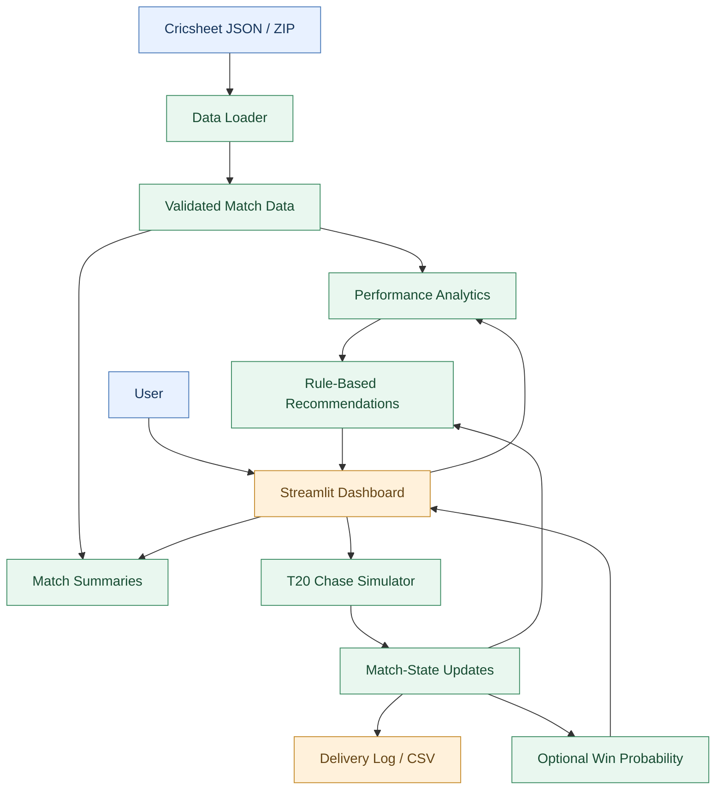
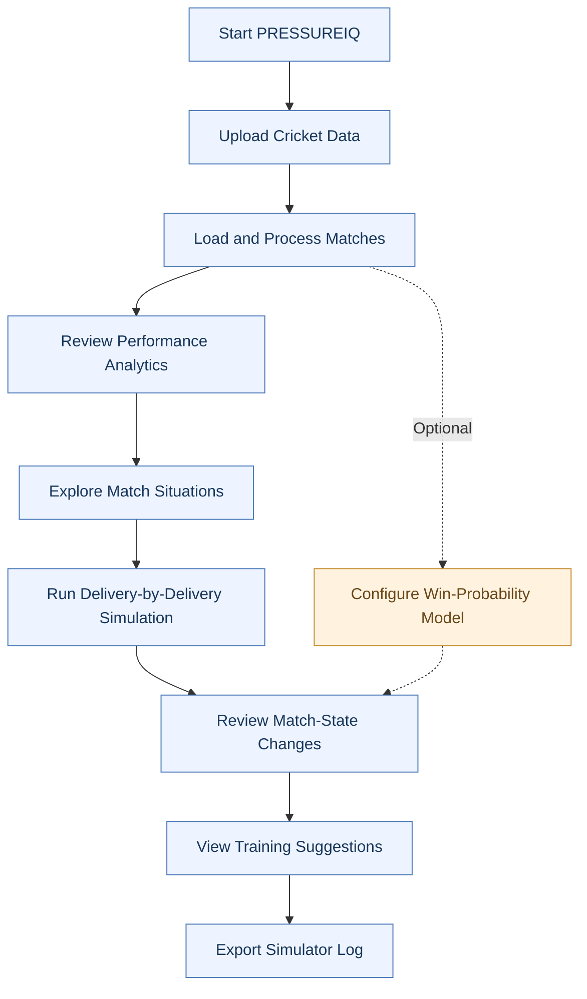
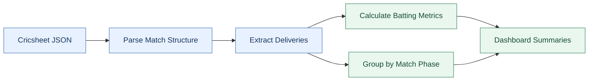
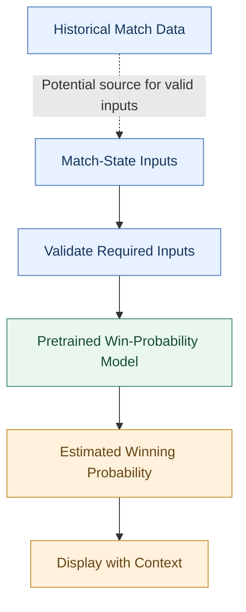

# 🏏 PRESSUREIQ
### Cricket Analytics • Match-State Intelligence • Scenario-Based Training

**Turn cricket data into smarter practice. Prepare for the moments that matter.**

PRESSUREIQ is a cricket analytics and training MVP that transforms historical match data into performance insights and interactive T20 chase scenarios. It combines batting analytics, delivery-by-delivery simulation, optional win-probability estimation, and rule-based training recommendations in one lightweight application.

Rather than treating a scorecard as the end of the analysis, PRESSUREIQ explores how match situations evolve, how different delivery outcomes affect a chase, and how players can use data to guide their practice.

> **Project focus:** Cricket performance analytics and match-situation training—not psychological diagnosis or emotion detection.

---

## 📌 Table of Contents

- [Overview](#-overview)
- [Why PRESSUREIQ?](#-why-pressureiq)
- [Features](#-features)
- [System Architecture](#-system-architecture)
- [How It Works](#-how-it-works)
- [Technology Stack](#-technology-stack)
- [Getting Started](#-getting-started)
- [Using Historical Cricket Data](#-using-historical-cricket-data)
- [Optional Win-Probability Model](#-optional-win-probability-model)
- [Project Structure](#-project-structure)
- [Testing](#-testing)
- [Data Integrity and Limitations](#-data-integrity-and-limitations)
- [Roadmap](#-roadmap)
- [Acknowledgements and Licensing](#-acknowledgements-and-licensing)

---

## 🎯 Overview

Cricket matches can change dramatically within a few deliveries. A team chasing a target may need to balance scoring speed against wickets in hand, while a bowling side must manage the remaining overs and runs required.

PRESSUREIQ provides a lightweight environment to analyze historical performance, experiment with match situations, and turn observations into structured practice.

| Component | Purpose |
|---|---|
| Performance Analytics | Summarize batting statistics and performance across match phases |
| Pressure Simulator | Explore a T20 chase one delivery at a time |
| Win Probability | Optionally estimate winning chances using a compatible pretrained model |
| Training Recommendations | Generate rule-based suggestions from available performance patterns |
| Practice History | Export recorded simulator delivery logs for further review |

### The core idea

**Historical data → Performance insights → Match simulation → Training recommendations**

PRESSUREIQ separates historical statistics, simulated outcomes, and model-based predictions so that users can understand what each result represents.

---

## 💡 Why PRESSUREIQ?

Traditional scorecards describe what happened. Analytics can help explain patterns in the available data, while simulation lets users explore hypothetical match situations.

PRESSUREIQ brings these ideas together in a single application.

- **Understand performance:** Explore batting output, strike rate, dismissals, and match phases.
- **Explore match situations:** Change delivery outcomes and observe how a chase evolves.
- **Add predictive context:** Optionally connect a pretrained win-probability model.
- **Turn insights into practice:** Use simple recommendations to identify areas worth exploring further.

The goal is to make cricket analytics accessible to players, students, coaches, and cricket enthusiasts without requiring specialized analytics software.

---

## 🚀 Features

### 1. 📊 Cricket Performance Analytics

Analyze uploaded Cricsheet match data to calculate descriptive batting statistics.

Available analytics include:

- Batter runs
- Legal balls faced
- Batting strike rate
- Innings appearances
- Recorded dismissals
- Batting performance by match phase
- Summaries of available second-innings and death-over data

These statistics are calculated from the uploaded dataset. Their usefulness depends on the completeness and coverage of the source matches.

### 2. 🏏 Interactive T20 Chase Simulator

Explore a chase delivery by delivery.

Configure a target, current score, wickets, and remaining deliveries, then apply delivery outcomes to observe changes in the match state.

The simulator is designed to make concepts such as runs required, deliveries remaining, and wickets in hand easier to explore.

Example scenario:

- Target: 180 runs
- Current score: 150
- Wickets lost: 5
- Deliveries remaining: 18

The simulator lets the user explore different possible outcomes from this situation. These are hypothetical scenarios, not reconstructions of an actual match unless explicitly based on one.

### 3. 📈 Optional Win-Probability Estimation

PRESSUREIQ provides an optional integration path for the pretrained Doosra win-probability model.

When correctly configured, the model can estimate winning probability from supported match-state inputs.

Model estimates are predictions, not guarantees. Their reliability depends on model assumptions, input quality, competition coverage, and match conditions.

### 4. 🧠 Rule-Based Training Recommendations

The application provides simple recommendations based on available performance patterns and simulation results.

These can help users identify areas for further practice, such as:

- Exploring scoring requirements during a chase
- Practicing different final-over situations
- Reviewing batting performance across match phases
- Comparing possible delivery outcomes
- Developing a consistent between-delivery reset routine

These recommendations are rule-based suggestions, not scientifically validated performance diagnoses.

### 5. 📝 Simulator Log Export

Export a simulator delivery log as CSV for later review, record keeping, or further analysis.

This supports experimentation without requiring a separate analytics platform.

---

## 🏗️ System Architecture

The application is organized into small Python modules that separate the user interface, data processing, analytics, simulation, and recommendations.



### Module responsibilities

| Module | Responsibility |
|---|---|
| `app.py` | Streamlit application and user interface |
| `src/data_loader.py` | Load supported Cricsheet JSON files and ZIP archives |
| `src/analytics.py` | Calculate batting metrics and performance summaries |
| `src/simulator.py` | Manage simplified chase states and delivery outcomes |
| `src/recommendations.py` | Generate rule-based training suggestions |
| `src/win_probability.py` | Optional integration with the pretrained model |
| `tests/test_simulator.py` | Simulator tests |

The architecture is intentionally lightweight. It avoids requiring a database server, cloud infrastructure, GPU, or a separately deployed backend for the current MVP.

---

## 🔄 How It Works



### Typical workflow

1. Launch the application.
2. Upload one or more supported Cricsheet JSON files or a ZIP archive.
3. Review the calculated batting metrics and match-phase summaries.
4. Open the pressure simulator.
5. Configure a chase scenario and explore delivery outcomes.
6. Review available training recommendations.
7. Export the simulator log if you want to retain the results.
8. Optionally configure the pretrained win-probability model.

---

## 🛠️ Technology Stack

| Technology | Role |
|---|---|
| Python 3.11 | Application logic |
| Streamlit | Interactive dashboard |
| Pandas | Tabular data processing |
| NumPy | Numerical operations |
| Plotly | Data visualization, where used in the application |
| Cricsheet | Historical cricket match data |
| Doosra Win Probability | Optional pretrained prediction component |
| Pytest | Automated testing |

The application is designed to run locally on a standard Windows computer. No GPU is required for the current MVP.

---

## 💻 Getting Started

### Prerequisites

- Windows 10 or Windows 11
- Python 3.11 recommended
- VS Code or another Python editor
- Internet access for installing dependencies and downloading optional datasets or model files

### 1. Download the project

Download or clone the PRESSUREIQ repository and open the project directory in VS Code.

If you use Git:

```powershell
git clone YOUR_REPOSITORY_URL
cd PRESSUREIQ
```

Replace `YOUR_REPOSITORY_URL` with the actual repository URL.

### 2. Create a virtual environment

```powershell
py -3.11 -m venv .venv
```

### 3. Activate the environment

```powershell
.\.venv\Scripts\Activate.ps1
```

If PowerShell blocks script execution, run:

```powershell
Set-ExecutionPolicy -Scope Process -ExecutionPolicy Bypass
.\.venv\Scripts\Activate.ps1
```

### 4. Install dependencies

```powershell
python -m pip install --upgrade pip
pip install -r requirements.txt
```

### 5. Launch PRESSUREIQ

```powershell
python -m streamlit run app.py
```

Streamlit will provide a local URL in the terminal. Open that URL in your browser.

### 6. Run the tests

```powershell
python -m pytest -q
```

A successful test run helps verify the components covered by the existing tests. It does not automatically validate every dashboard feature or optional model integration.

---

## 🗂️ Using Historical Cricket Data

PRESSUREIQ is designed to analyze data supplied by the user.

### Recommended data source

**Cricsheet:** https://cricsheet.org/

Cricsheet provides structured ball-by-ball cricket data for supported competitions.

### Getting started with a small dataset

1. Open the Cricsheet downloads page.
2. Select a supported T20 dataset.
3. Download the relevant JSON data.
4. Extract the archive if required.
5. Upload an individual JSON file or a ZIP archive containing JSON files through the application sidebar.

For initial testing, use one or a few matches instead of downloading the entire dataset.

### Suggested data directory

```text
PRESSUREIQ/
└── data/
    └── sample_matches/
        └── match.json
```

This directory is an example for organizing local files. The application's sidebar uploader is the intended input path described by this MVP.

### Data-processing flow



**Important:** The quality of an analysis depends on the number of matches uploaded, the formats represented, and the completeness of the underlying data. A small sample is suitable for testing the application, not for drawing broad conclusions about player ability.

---

## 🎯 Optional Win-Probability Model

PRESSUREIQ supports an optional integration path for the Doosra win-probability model.

**Model repository:** https://huggingface.co/Sarthak213/doosra-win-probability

### Setup

1. Download the compatible `predict.py` and `winprob-t20.json` files from the model repository.
2. Create a `models` directory in the PRESSUREIQ project root.
3. Place both files inside it.
4. Configure the model path in the application, if required.
5. Restart the application and test the model with a documented example.

Expected directory layout:

```text
PRESSUREIQ/
├── app.py
├── models/
│   ├── predict.py
│   └── winprob-t20.json
├── src/
│   └── win_probability.py
└── requirements.txt
```

### Model integration concept



### Model-input considerations

The documented model interface uses inputs such as:

- Innings number
- Current score
- Wickets lost
- Deliveries remaining
- Target
- Venue-par estimate
- Team Elo difference

Do not treat missing inputs as known facts. If valid venue or team-strength information is unavailable, disclose any defaults or assumptions used.

The optional integration should be treated as unavailable until the model files have been downloaded, the interface has been tested, and predictions have been verified against documented examples.

---

## 📁 Project Structure

```text
PRESSUREIQ/
│
├── app.py
├── requirements.txt
├── README.md
│
├── data/
│   └── sample_matches/
│
├── models/
│   └── # Optional model files; not required for basic use
│
├── src/
│   ├── __init__.py
│   ├── data_loader.py
│   ├── analytics.py
│   ├── simulator.py
│   ├── recommendations.py
│   └── win_probability.py
│
├── tests/
│   └── test_simulator.py
│
└── outputs/
```

The `models/`, `data/`, and `outputs/` directories are used for optional model artifacts, local data organization, and generated outputs, respectively. Create them when needed if they are not already present.

---

## 🧪 Testing

Run the automated tests with:

```powershell
python -m pytest -q
```

Recommended manual checks include:

- Uploading a valid Cricsheet JSON file.
- Uploading a ZIP archive containing supported JSON files.
- Confirming that batting statistics appear for the selected dataset.
- Checking how the application handles missing or unsupported data.
- Testing delivery outcomes in the simulator.
- Exporting and opening the simulator CSV.
- Running the optional model test separately after model setup.

Testing should cover both valid inputs and edge cases before using the application for broader analysis.

---

## 🔍 Data Integrity and Limitations

PRESSUREIQ is an MVP. Its current scope is deliberately narrower than a full professional cricket analytics platform.

### Analytics limitations

- Statistics only represent the match files uploaded by the user.
- Phase boundaries are based on over numbers: powerplay 0–5, middle overs 6–14, and death overs 15 onward. Interpret these according to the match format and innings length.
- Aggregated player summaries depend on the uploaded sample and should not be interpreted as universal player rankings.
- Match identifiers may not be globally unique.
- The second-innings chase summary is an approximate batter-level summary, not a complete reconstructed ball-by-ball match-state analysis.

### Simulator limitations

- The simulator uses simplified chase-state logic.
- It does not model every cricket rule or all extra-ball edge cases.
- Simulated outcomes should not be confused with historical deliveries or actual match results.

### Prediction limitations

- The Doosra model is an optional external dependency.
- Integration must be verified in the target environment before predictions are relied upon.
- Predictions depend on the model's supported inputs, training data, and assumptions.
- Win probability is not a guarantee of a match result.

### Training limitations

- Recommendations use simple rules and are not scientifically validated psychological assessments.
- The application does not directly measure stress, confidence, emotions, or a player's mental state.
- Training suggestions should be interpreted as prompts for practice rather than professional coaching or medical advice.

**Our principle:** Keep historical observations, simulations, and predictions distinguishable. Do not fabricate data or imply greater certainty than the available evidence supports.

---

## 🛣️ Roadmap

The following are potential improvements, not claims about features already completed.

### Phase 1 — Strengthen the MVP

- [ ] Validate data parsing across additional Cricsheet matches.
- [ ] Add clearer validation messages for unsupported or incomplete data.
- [ ] Improve simulator edge-case handling.
- [ ] Verify the optional win-probability integration end to end.
- [ ] Add more automated tests.

### Phase 2 — Deeper Cricket Analytics

- [ ] Add bowling economy, wickets, and bowling-phase analysis.
- [ ] Reconstruct match states from individual deliveries.
- [ ] Support player-versus-player comparisons where the data permits.
- [ ] Add filters for teams, competitions, formats, and match periods.
- [ ] Provide clearer sample sizes and data-coverage indicators.

### Phase 3 — More Useful Practice

- [ ] Introduce configurable scenarios for different chase situations.
- [ ] Track practice sessions over time.
- [ ] Generate more specific recommendations from validated performance metrics.
- [ ] Compare simulated scenarios with comparable historical situations.
- [ ] Explore player-specific training profiles.

### Long-term vision

Build an accessible cricket analytics and scenario-training platform that connects match data with practical learning—helping users understand performance patterns, explore match decisions, and practice for different game situations.

---

## 🙌 Acknowledgements and Licensing

### Data

**Cricsheet:** https://cricsheet.org/

Review Cricsheet's current data terms before redistributing datasets or derived artifacts. Attribute the source where required.

### Optional model

**Doosra Win Probability:** https://huggingface.co/Sarthak213/doosra-win-probability

Review the model repository's license, attribution requirements, and terms for the exact files used. The model card describes an ODC-By 1.0 release; verify the applicable terms before redistribution.

### Project code

PRESSUREIQ is presented as an MVP project. Add an explicit repository code license if you intend to authorize public reuse, modification, or redistribution.

---

## 🏏 Final Note

PRESSUREIQ explores how cricket analytics can become more interactive and useful for practice.

By bringing together historical performance summaries, a simplified T20 chase simulator, optional win-probability estimation, and rule-based recommendations, the project provides a foundation for more data-informed cricket training.

**Analyze the game. Explore the situation. Prepare for the next delivery.**
